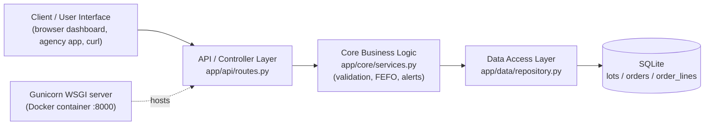

# System Architecture

## 1. Architectural Style

- **Pattern:** N-Tier Layered Architecture (Presentation/API -> Core Services -> Data Access), packaged as a single containerized service (modular monolith).
- **Rationale:** The prototype is small and built by a five-person student team, so one deployable unit keeps build, test and deployment simple. Strict layering keeps the FEFO and validation rules in `app/core` independent of Flask and SQLite. That lets them be unit-tested without a web server, and lets the storage layer later move to PostgreSQL (the target cloud design in the Phase 1 report) without touching business logic. The same layers map directly onto the planned Agency Portal, Inventory and Forecasting modules if the system is later split into services.

## 2. Component Interaction Diagram (Mermaid)

## 3. Data Flow & Execution Lifecycle

1. **Ingestion:** HTTP requests reach Gunicorn inside the container (port 8000), which hands them to the Flask app. Blueprints route `/` and `/health` to the web layer and `/api/*` to the REST controllers, which parse the JSON body.
2. **Processing:** Controllers call `app.core.services`. Donations are validated (required fields, quantity > 0, expiry not in the past). Orders filter out expired lots, sort the rest by expiry then lot id, and `plan_fefo` takes stock lot by lot until the request is met. The order is then marked FILLED, PARTIAL or BACKORDERED. Validation failures raise `ValidationError`, which the API turns into HTTP 400.
3. **Persistence & Response:** `Repository.save_order` inserts the order and its order lines and decrements each picked lot inside one SQLite transaction, guarded by a lock, so stock can never be double-allocated. The controller returns JSON with HTTP 201. The dashboard renders the current lots, with expiring ones highlighted.

## 4. Architecture Decision Records (ADRs)

- **ADR-01 (Layered monolith over microservices):** *Context:* a prototype for a term project with a 26-week plan and a small team. *Decision:* a single Flask service with strict internal layers. *Trade-offs:* the parts cannot be scaled independently, but deployment, testing and debugging are much simpler, and the layers leave a clean path to split services later.
- **ADR-02 (SQLite for the prototype, PostgreSQL in production):** *Context:* the lab needs a self-contained image that runs anywhere. *Decision:* SQLite (in-memory by default, file via `PANTRYLINK_DB`). *Trade-offs:* no concurrent multi-instance writes and data is lost when an in-memory container restarts. This is acceptable for a demo, and the repository layer isolates the change.
- **ADR-03 (FEFO allocation in the service layer):** *Context:* the main business goal is cutting spoilage from 9% to 5% or less. *Decision:* allocation always picks the earliest-expiring, non-expired lot first, implemented as a pure function (`plan_fefo`) with unit tests. *Trade-offs:* fair-share allocation between agencies is not yet modelled; it is planned for a later sprint.
- **ADR-04 (Gunicorn in a slim Python image):** *Decision:* serve with Gunicorn (1 worker, 4 threads) on `python:3.12-slim` instead of the Flask development server. A single process is required while the default database is in-memory SQLite, because separate worker processes would each hold their own copy of the data; threads give concurrency, and the repository serialises writes with a lock. *Trade-offs:* the image is slightly larger than Alpine but avoids musl build problems; scaling out to more processes needs the PostgreSQL move in ADR-02.
